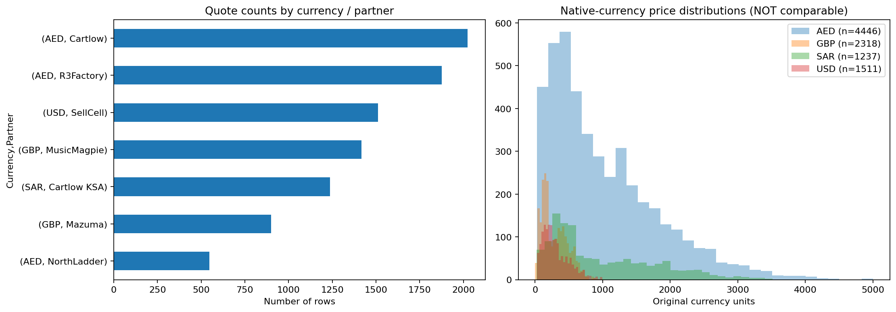
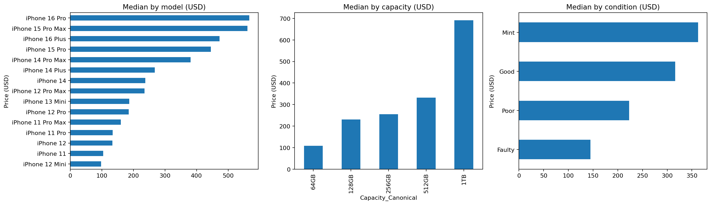
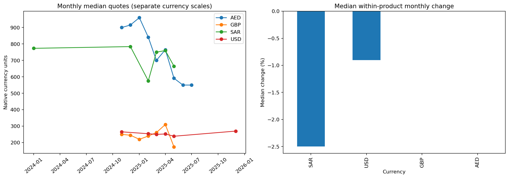
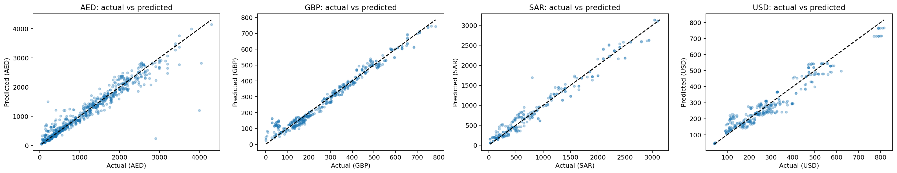
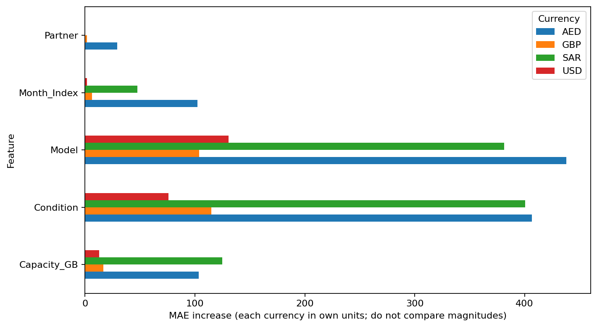

# iPhone Resale Price Analytics & Machine Learning

### A Multi-Platform Data Analytics and Price Prediction Project

**Python | Pandas | Exploratory Data Analysis | Scikit-learn | Random Forest | Data Visualization**

## Project Overview

This project investigates how iPhone model, storage capacity, device condition, resale platform, and time relate to smartphone buyback prices.

Using a multi-platform dataset, I developed a reproducible analytics workflow covering data quality assessment, exploratory data analysis (EDA), machine learning, model evaluation, and business interpretation.

The objective is to identify important pricing patterns and evaluate whether machine learning can predict buyback quotes more accurately than a simple baseline.

**Research Question:**

> How do product specifications, device condition, resale platforms, and time relate to iPhone buyback prices, and how accurately can machine learning estimate these quotes?

## Project Highlights

- Integrated and assessed iPhone buyback quote data from multiple resale platforms.
- Applied data quality checks covering missing values, storage capacity, price validity, dates, and currency verification.
- Analyzed relationships between iPhone specifications, condition, time, and buyback prices.
- Developed currency-specific Random Forest regression models.
- Compared machine learning performance against a median-price baseline.
- Evaluated predictive performance using MAE, RMSE, R², and WAPE.
- Used permutation importance to interpret the model's most influential features.

## Dataset & Data Quality

The initial consolidated dataset contained **9,839 candidate observations**.

After additional quality checks, **9,512 observations** were retained for analysis and modeling, while 327 were flagged for further review.

The dataset contains buyback quotes denominated in:

- USD — US Dollar
- GBP — British Pound
- AED — UAE Dirham
- SAR — Saudi Riyal

To avoid combining incompatible monetary values, separate regression models were trained and evaluated for each currency.

**Important:** These observations represent platform buyback quotes, not necessarily completed secondhand market transactions.

## Exploratory Data Analysis

The exploratory analysis examines:

**1. Price Distribution**

How buyback quotes vary across platforms and currencies.



**2. Model, Storage Capacity & Condition**

How product specifications and device condition relate to quoted prices.



**3. Monthly Price Trends**

How buyback quotes change over time, including comparisons of matching product specifications across adjacent months.



## Machine Learning Methodology

### Target Variable

The prediction target is the original-currency buyback quote (`Price_Original`).

### Predictive Features

The model uses:

- Resale platform (`Partner`)
- iPhone model (`Model`)
- Storage capacity (`Capacity_GB`)
- Device condition (`Condition`)
- Quote month (`Month_Index`)

Categorical features are encoded using One-Hot Encoding.

### Models

**Median Baseline**

A simple benchmark that predicts the training-set median price.

**Random Forest Regressor**

An ensemble learning algorithm that combines multiple decision trees to capture nonlinear relationships between product attributes and buyback prices.

### Model Validation

An approximately 80/20 group-based train/test split was used to reduce leakage between observations sharing the same product-condition group.

This evaluation measures performance on held-out product groups rather than future-month forecasting.

## Machine Learning Results

Random Forest substantially outperformed the median-price baseline across all four currency-specific models.

| Currency | Random Forest MAE | R² | WAPE |
|---|---:|---:|---:|
| USD | $36.61 | 0.926 | 12.45% |
| GBP | £21.82 | 0.971 | 7.92% |
| AED | 115.76 | 0.932 | 10.74% |
| SAR | 104.67 | 0.964 | 11.70% |

**Interpretation:** The models demonstrate strong predictive performance on the held-out test groups, although results should not be interpreted as validated forecasts of future market prices.

### Actual vs Predicted Prices



## Feature Importance

Permutation importance was used to evaluate how strongly model performance depends on each feature.

Across the four currency-specific models, **iPhone model and device condition were consistently the two most influential predictors**.



Feature importance reflects predictive dependence and should not be interpreted as causal evidence.

## Business Implications

**1. Product-specific pricing**

Differences across iPhone models suggest that buyback pricing tools should account for product specifications rather than relying on a single market-wide reference price.

**2. Condition-sensitive valuation**

Device condition is a major predictive factor, highlighting the importance of consistent grading standards in buyback operations.

**3. Data-driven quote estimation**

Machine learning can support preliminary buyback quote estimation and pricing analysis, subject to additional validation.

**4. Data quality and governance**

Reliable pricing analytics require careful treatment of currency differences, repeated observations, missing values, and potentially derived prices.

## Project Limitations

- The dataset contains buyback quotes rather than verified completed transactions.
- The data may not represent the full secondhand smartphone market.
- Currency-specific models are not directly comparable using absolute monetary errors.
- Some source observations are aggregated product-month quotes rather than independent transactions.
- The evaluation uses a group-based split, not chronological validation.
- Predictive importance does not establish causation.
- Further data-source verification and time-based validation would be required before production deployment.
- Four records from Mazuma contain spreadsheet formula errors in the Zension_Grade field. These values were identified during data quality checks and were not used as predictive features.

## Repository Structure

```text
iphone-resale-price-analytics/
├── README.md
├── notebooks/
│   └── iPhone_Resale_EDA_ML_Portfolio.ipynb
├── figures/
│   ├── 01_source_and_prices.png
│   ├── 02_model_capacity_condition.png
│   ├── 03_monthly_trends.png
│   ├── 04_ml_actual_vs_predicted.png
│   └── 05_feature_importance.png
├── results/
│   ├── ml_model_comparison.csv
│   └── ml_test_predictions.csv
└── .gitignore
```

## Tools & Technologies

- **Python:** Data analysis and machine learning
- **Pandas & NumPy:** Data manipulation and validation
- **Matplotlib:** Data visualization
- **Scikit-learn:** Preprocessing, Random Forest, and model evaluation
- **Google Colab:** Cloud-based notebook execution
- **GitHub:** Version control and project documentation

## Future Improvements

- Conduct time-based validation to assess future-month generalization.
- Evaluate additional regression algorithms and hyperparameter tuning.
- Improve currency-specific visualizations and cross-market comparability.
- Further investigate model errors across product segments.
- Develop an interactive buyback price estimation dashboard.

---

**Project Focus:** Data Analytics | Machine Learning | Pricing Analytics | Business Insights
